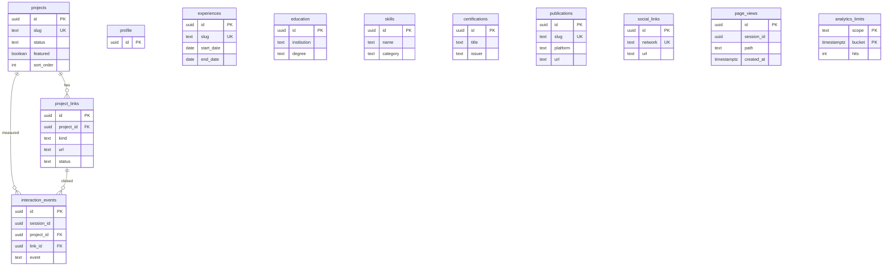

# Database contract

Migrations: `supabase/migrations/202611010001_portfolio.sql` and `202611010002_harden_dashboard_trigger.sql`. Initial import: `supabase/seed.sql`.



All nine content tables are in `public`; the three analytics tables and seven reporting views are in `private`, which is not a Data API schema. Every table has RLS enabled. Content rows have UUID IDs, `status` (draft/published), `sort_order`, `created_at`, and trigger-maintained `updated_at`.

| Table                      | Additional fields / constraints                                                                                                                                                                        |
| -------------------------- | ------------------------------------------------------------------------------------------------------------------------------------------------------------------------------------------------------ |
| profile                    | slug, name, title, headline, introduction, about, location, email, image_url, resume_url, current_focus. One published profile maximum.                                                                |
| projects                   | slug, title, category, summary, description, role, organization, start_date, end_date, problem, approach, responsibilities[], outcomes[], technologies[], image_url, image_alt, visual_kind, featured. |
| project_links              | project_id FK with cascading delete, kind, label, url. Published link readable only if parent project is also published.                                                                               |
| experiences                | slug, company, position, location, start_date, end_date, highlights[].                                                                                                                                 |
| education                  | institution, degree, start_year, end_year, url.                                                                                                                                                        |
| skills                     | name, category; unique pair.                                                                                                                                                                           |
| certifications             | title, issuer, issued_on, url. If only a year is supplied, use Jan 1 of that year; UI renders year only.                                                                                               |
| publications               | slug, title, summary, platform, published_on, url, featured. A missing exact publication date stays null.                                                                                              |
| social_links               | unique network, url.                                                                                                                                                                                   |
| private.page_views         | event UUID, page-memory session UUID, path, referrer domain, UTM object, server timestamp.                                                                                                             |
| private.interaction_events | same event/session/path fields plus event, project_id, link_id, platform.                                                                                                                              |
| private.analytics_limits   | scope and minute bucket composite key, atomic hit count.                                                                                                                                               |

Slugs are stable lowercase hyphenated strings; do not change a published project slug without preserving a redirect/deep-link mapping. Technologies, responsibilities and outcomes are scalar arrays belonging to a project; links and skills are normalized into independent dashboard-managed records. This avoids artificial case-study paragraph tables while keeping all content editable.

`src/lib/database.generated.ts` is generated by introspecting the migrated real PostgreSQL database with `scripts/generate-db-types.py`. Reproduce with `PORTFOLIO_GENERATE_TYPES=1 npm run test:policies`. The application read model derives its rows from these generated types. The same migration and policy suite were also applied to the hosted Supabase project. Once linked with Supabase CLI, you can instead refresh the contract with the official generator:

```bash
supabase gen types typescript --linked > src/lib/database.generated.ts
```

The public frontend never accesses private types, service credentials or authentication sessions.

## Analytics entry boundary

`public.ingest_analytics(jsonb)` is `SECURITY DEFINER`, has an empty search path, accepts only the Edge Function's server role, checks project/link publication, enforces atomic per-session and global limits, and deduplicates event UUIDs. Anonymous and ordinary authenticated roles have no execution privilege. Content administration is through the owner's Supabase dashboard, not a public admin UI.
